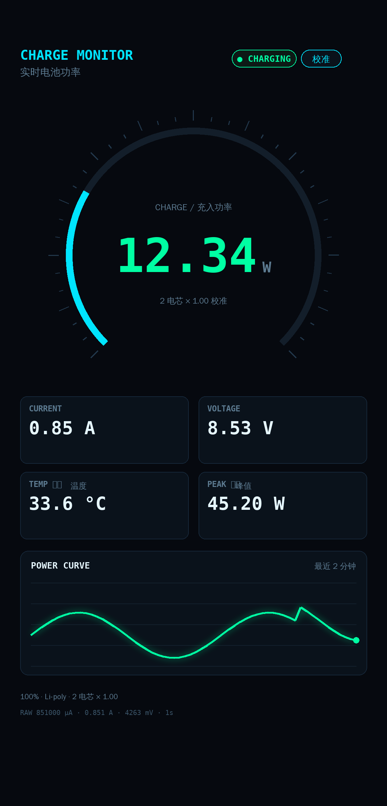
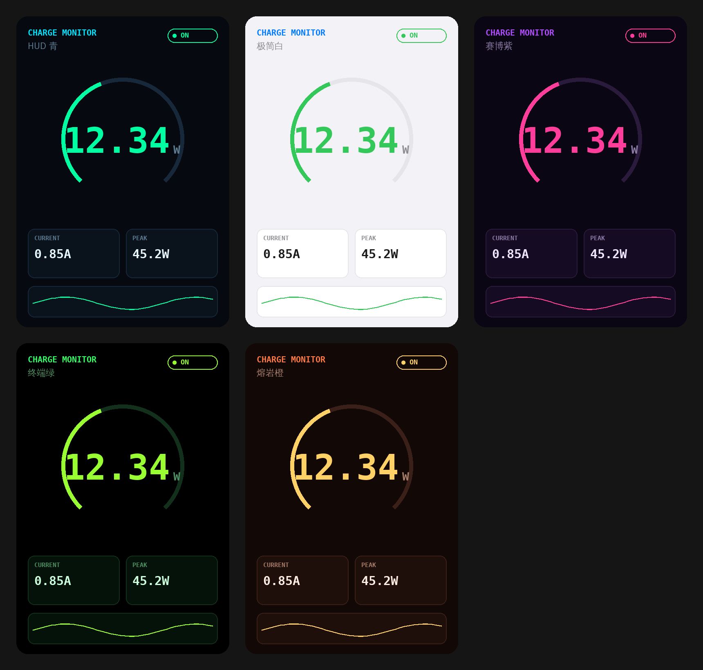

[](https://github.com/123xxss/ChargeMeter/releases)
[](https://github.com/123xxss/ChargeMeter/releases/download/v5.1/ChargeMeter_v5.1.apk)

[](LICENSE)
[](https://github.com/123xxss/ChargeMeter/actions/workflows/build.yml)

# ChargeMeter · 充电功率

一个干净、没有广告和联网权限的 Android 实时充电功率监视器。用系统 `BatteryService` 的电池侧数据实时计算功率，环形仪表 + 曲线 + 多套主题，适配国产 ROM 的双电芯快充。



## 功能

- **实时功率**（保留两位小数），充入显示绿色、放电显示青色
- **电流 / 电压 / 温度 / 峰值** 四宫格，等宽字体，数据每秒刷新
- **环形仪表**：270° 刻度弧，功率越高弧越长
- **功率曲线**：最近 2 分钟趋势，霓虹渐变填充
- **5 套主题**：HUD 青、极简白、赛博紫、终端绿、熔岩橙，一键切换并记住选择
- **充电等级**：涓流 / 标准 / 快速 / 超快 自动判定
- **全中文界面**，单位使用 W / A / V 等标准符号
- **校准**：电芯数（1~4）与倍率（0.1~10）可调，用来对齐 ROM 自己显示的瓦数
- 无网络权限、无广告、不收集任何数据

<table>
<tr><td></td></tr>
</table>

## 原理与坑（重要）

Android 只向普通应用暴露**电池侧**数据，没有充电器输入功率：

| 数据 | 来源 | 单位 | 坑 |
|---|---|---|---|
| 电流 | `BatteryManager.BATTERY_PROPERTY_CURRENT_NOW` | **µA** | 少数 ROM 上报 mA；不支持时返回 `Long.MIN_VALUE` |
| 电压 | `ACTION_BATTERY_CHANGED` 的 `EXTRA_VOLTAGE` | **mV**，**单电芯** | 部分联发科 OPPO / 一加 / realme 上报异常 |
| 温度 | `EXTRA_TEMPERATURE` | 0.1 °C | 个别机型恒为 0 |

计算方式：

```
功率 = |电流| × 电压(V) × 电芯数 × 校准倍率
```

**为什么双电芯机型功率会少一半**：双电芯串联的机器，系统上报的是**单个电芯**电压（如 4.3 V），但电流是整包回路电流。所以串联双电芯必须把「电芯数」设为 **2**，否则显示的功率只有实际的一半。

本项目做了几层兜底：

1. 电流固定按 µA 解析，若算出的功率 > 400 W，自动按 mA 重算一次（防个别 ROM 上报毫安）
2. 电流不支持（`Long.MIN_VALUE`）时显示 `--` 并提示机型未开放该接口
3. 电压超出 2.5 V ~ 5.0 V 视为异常，界面提示建议校准，避免显示离谱数值
4. 首次启动按品牌猜电芯数（小米/Redmi/POCO、OPPO/一加/realme、vivo/iQOO、荣耀/华为默认 2），用户可在「校准」里改

## 兼容性

| 平台 | 状态 | 说明 |
|---|---|---|
| vivo / iQOO（OriginOS，Android 14~16） | ✅ 实机验证 | `AUTO`/`ORIGIN` 的涓流阶段电流极小，需注意单位 |
| 小米 / Redmi / POCO（HyperOS） | ⚠️ 按同套 API 适配 | 双电芯设为 2；其余走兜底逻辑 |
| OPPO / 一加 / realme（ColorOS / realme UI） | ⚠️ 按同套 API 适配 | 部分联发科机型电压上报异常，界面会提示 |
| 荣耀 / 华为 | ⚠️ 按同套 API 适配 | 同上 |
| 原生 Android / Pixel | ✅ | 单电芯，电芯数填 1 |

`minSdk 29`（Android 10）`targetSdk 36`（Android 16）。原理上所有提供 `BatteryManager` 的标准 Android 设备都能用，差异集中在**电芯数**和**电压上报**两项，所以做了校准入口而不是写死机型表。

## 构建

不需要 Gradle，用 aapt2 + javac + d8 + apksigner 直接出包。

依赖：

- JDK 17+
- Android **build-tools**（提供 `aapt2` `zipalign` `d8` `apksigner`）
- Android **platform** 的 `android.jar`（compileSdk 34+，脚本默认 36）
- 在 ARM 主机（如手机上的 proot）上运行 x86_64 版的 `aapt2` / `zipalign` 需要 `qemu-user-static`

```bash
# x86_64 主机
ANDROID_SDK_ROOT=$HOME/android/sdk bash build.sh

# ARM 主机（用 qemu 跑 x86_64 工具）
ANDROID_SDK_ROOT=$HOME/android/sdk QEMU=qemu-x86_64-static bash build.sh
```

可用环境变量：`ANDROID_SDK_ROOT`、`BUILD_TOOLS_DIR`、`ANDROID_JAR`、`QEMU`、`KEY_ALIAS`。

首次构建会自动生成 `signing.keystore`（口令 `android`）。**正式发布请换成你自己的 keystore，并把 `signing.keystore` 排除在仓库外**（`.gitignore` 已包含）。

> 直接下载：[**ChargeMeter_v5.1.apk**](https://github.com/123xxss/ChargeMeter/releases/download/v5.1/ChargeMeter_v5.1.apk)（Release 附件）

```bash
adb install -r chargemeter.apk
```

国产 ROM 安装未备案应用需要手动确认，属于正常现象。

## 已知限制

- 只能读**电池侧**功率，不是充电器输出功率。想看适配器输入功率需要 root 读 `/sys/class/power_supply/primary_chg/*`
- 100% 满电后电流可能为负（电池在放电供系统），此时标题会变成「放电功率」，属正常现象

## License

[MIT](LICENSE)
